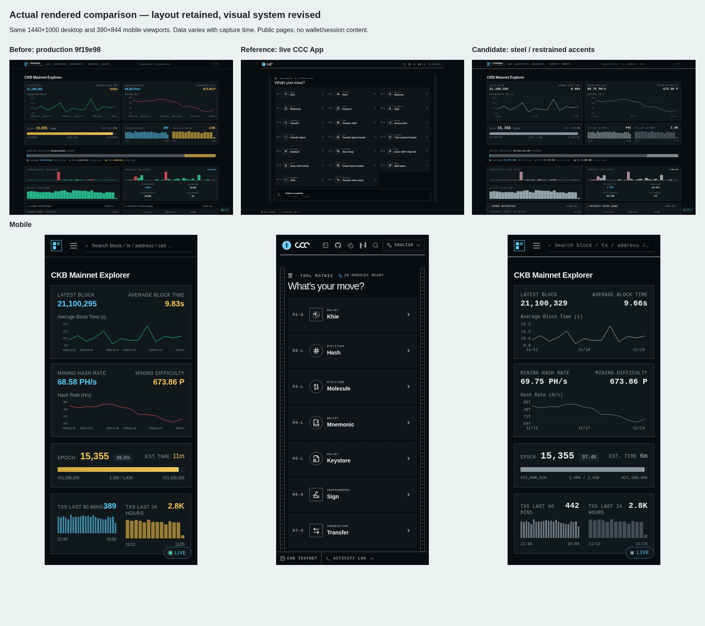

# Rendered visual review — iteration 2

Actual public browser captures: production at 9f19e98, https://app.ckbccc.com/, and local candidate. Desktop 1440×1000; mobile 390×844. No images from the restricted Library file were accessed or reused. Data and relative timestamps vary across capture times.

Reference source: ckb-devrel/ccc 0961763da4a81c954e156a27c581aed0aeca9761, packages/app/src/app/styles/tokens.css, shell.css and module-controls.css. Rendered CCC is itself almost black; its stronger differentiator is neutral ink/steel, mono metadata, ruled framing and restrained cyan interaction. The prior Explorer used this background but retained dominant green/gold/pink/violet series and glowing details.

This candidate retains the layout and route/data logic. Primary metrics are neutral ink; chart series use labeled steel tones, negatives muted rose. Epoch progress is flat, status markers square and unlit, hash hover no longer glows or scales, panels use steel rules, and decorative scans/gradients are suppressed on common surfaces. Warning/error semantics remain distinct. Mobile search ellipsis and chart tick readability improved.

Found and corrected a previous font regression: Tailwind fontFamily had been accidentally transformed into RGB expressions during the opacity fix. It now correctly references --font-mono and --font-display; production CSS assertions cover both font mappings as well as all 21 alpha-capable color aliases.

An independent visual reviewer actually inspected all six screenshots, then reinspected the corrected candidate and contact sheet. Final conclusion: no blocking issue in these home-page frames; layout intact, neutral treatment visibly reduces neon/rainbow character, improved mobile labels and consistent negatives. Stills do not establish motion or functionality.

Verification: 33 targeted tests passed before final refinements; 28 home/search/transaction tests passed after refinements. Next TypeScript/build/export and compiled font/color assertions passed. Browser desktop/mobile keyboard search navigated to block 21099925; actual transaction 0x208090332e1b30163e1412df24186595dbd0d9d08d2fdf5c13cbcee396d4e79a witness selection retained 25% background and 70% ring; no page overflow at 390px. Status animation and shadow are none; normal search transition 150ms, reduced-motion 0.01ms. Font resolves Courier New rather than fallback sans.

Limitations: dark presentation only pending complete light semantic palette validation. Public backend data is mutable; the environment needed a certificate trust workaround for browser requests. All secondary/rare artwork, every chart category combination and every assistive technology were not exhaustively reviewed. Live source view was compared, not just token names. This candidate is not deployed pending parent review.
