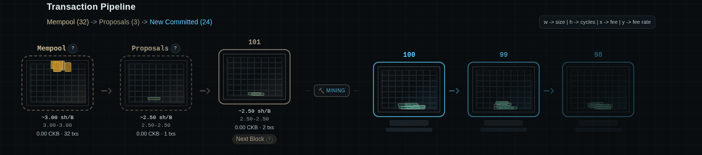
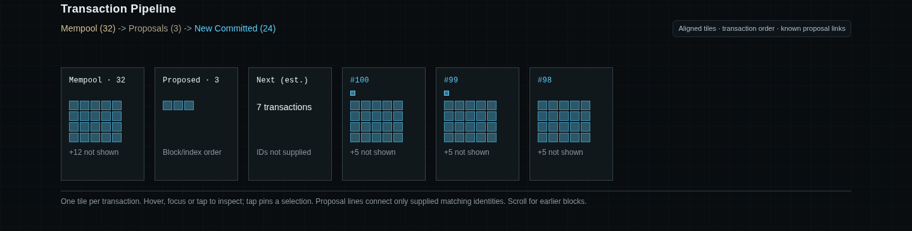
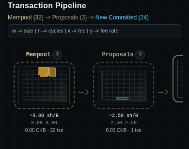
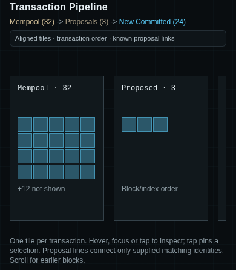

# Ordered Transaction Pipeline preview

Preview only; production remains at `ad3061be5fad7cfcbbaec041302eac726e8d2833`.

## Reference and scope

Janx upstream main resolved to [`ded8f6aa9b74256c49f91866f36581eeda5ca109`](https://github.com/janx/ckbadger/tree/ded8f6aa9b74256c49f91866f36581eeda5ca109). Source references: [fixed-grid layout](https://github.com/janx/ckbadger/blob/ded8f6aa9b74256c49f91866f36581eeda5ca109/frontend/lib/pipeline/layout.ts) and [proposal connector interaction](https://github.com/janx/ckbadger/blob/ded8f6aa9b74256c49f91866f36581eeda5ca109/frontend/components/pipeline/pipeline-panel.tsx). This borrows ordered plates and known-identity connections, not the newer backend snapshot contract or variable-area encoding. No independently rendered upstream-main comparison is claimed.

The homepage section and stage order stay in place. Equal tiles replace fee-coordinate scatter. Committed samples sort by transaction index; proposals by origin block/index; pending transactions by hash (not a claimed arrival order). The v0.8.3 prediction supplies only aggregates: Next remains an estimate, with no invented transaction identities. Existing block and transaction routes remain intact.

Only a supplied full transaction hash plus a visible supplied proposal origin can produce a connector. Hover or keyboard focus previews; tap/click pins for horizontal scrolling. Escape/Clear releases it. Missing identities and offscreen origins have explicit no-match feedback. Mobile targets are 24px; desktop cells are 15px. The strip scrolls internally and supports keyboard scrolling; no page-width breakout.

## Matched viewport comparisons

All captures below are our own browser output. No private user screenshot is included. Before is deployed ad3061b; after is the local candidate with the same deterministic API fixtures and reduced motion.

| View | Before | Candidate |
|---|---|---|
| Desktop 1440 |  |  |
| Mobile 390 |  |  |

Full pages: [desktop](after-1440-full.png), [mobile](after-390-full.png).

Interaction evidence: [320px keyboard connector](320-keyboard-connector.png), [390px pinned and scrolled target](390-pinned-target.png), [desktop connector](1440-keyboard-connector.png), [empty](390-empty.png), [error](390-error.png).

## Validation

- Full local Vitest suite: 935 tests / 143 files passed.
- Next production build, TypeScript, static export and opacity CSS checks passed.
- Deterministic browser regression: 320/390/1440 widths × populated/empty/error states. Checks reversed-input index sorting, equal rows/pitch, mobile target dimensions, actual connector endpoint coordinates, keyboard focus, hover, pin/scroll/Escape, unmatched and missing identities, exact transaction destination, overflow counts and page containment.
- Existing long-feed clipping/hit-test/keyboard/Latest Blocks regression remains in the combined browser gate. Both validation and Pages workflows invoke it, followed by pipeline checks, against mocked endpoints under the Pages prefix.
- Independent visual reviewer inspected desktop/mobile comparisons, connector and following sections; the mobile-target finding was corrected and recaptured. No new pipeline clipping/readability blocker remained.
- Public-backend smoke against the local candidate loaded 10 blocks and 17 visible tiles at each viewport. That final snapshot had zero proposed transactions, so a live-data connector was **not** verified. See [observations](live.json), [mobile](live-390.png), [desktop](live-1440.png). Connector behavior is proven with deterministic fixtures, not a production event.

## Limits

At most 20 tiles per plate, ten recent blocks, 80 fetched transactions per block and five supplied origin markers per block are displayed. Overflow is stated. Committed ordering applies to the fetched sample, not a claim of complete block coverage. The origin mapping trusts v0.8.3 API fields; no cryptographic proposal reconstruction is added. Legacy coordinate components used elsewhere remain unchanged. Dynamic live data and counts may differ from screenshots. A separate Activity Stats compact-label fallback seen in synthetic full-page data predates this scoped pipeline change.

Implementation: `frontend/components/chain-wave/ordered-pipeline.tsx`, `frontend/lib/ordered-pipeline.ts`; entry point `pipeline-preview.tsx`. Browser assertions: `frontend/scripts/verify-ordered-pipeline.cjs` and `verify-home-ci.cjs`.
