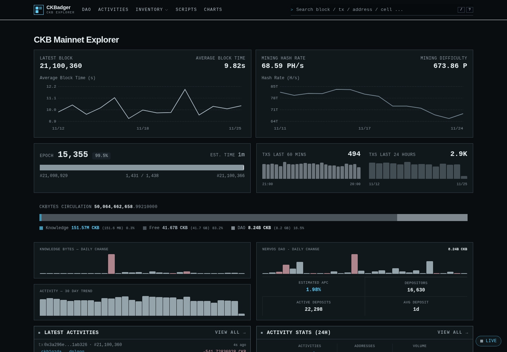
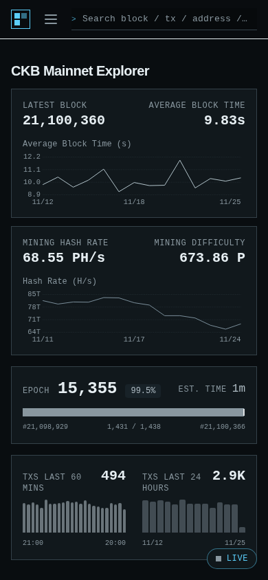
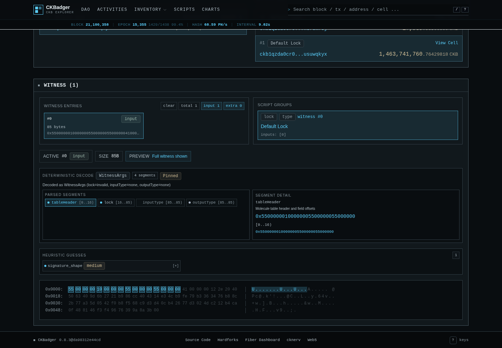
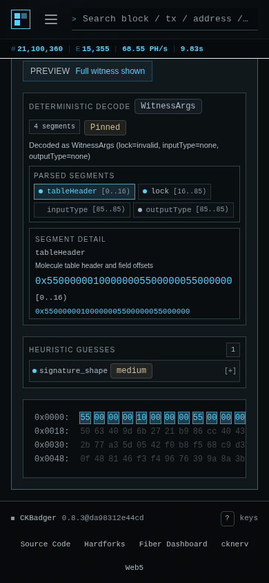

# Live deployment verification

Published commit: f1187c58a1ed5c40b2605bf67320f642be31681b.

[Live Explorer](https://hanssen0-alter-ego.github.io/ckbadger-explorer/)
[Successful Pages run 45484313601](https://github.com/Hanssen0-Alter-Ego/ckbadger-explorer/actions/runs/45484313601)
Deployment 8040313811 reports success and the same SHA.

Entire frontend suite: 930 tests in 141 files passed locally. Hosted release subset: 91 tests passed. TypeScript/export and compiled CSS color/font assertions passed.

These are fresh screenshots of the published site, not the user's uploaded screenshot. Desktop 1440×1000; mobile 390×844. Backend data varies with capture time. Verified neutral chart stroke #b7c8d0 and Courier New mono typography in the live DOM. Keyboard suggestion selection navigated to block 21099925 on both sizes; selected witness background and ring opacities match. No document overflow. Color checks under both OS preferences retain the supported dark palette.

The block-time and hash-rate panels retain separate titles and unit labels. Transaction time windows are labeled independently. Knowledge/Free/DAO segments retain legends and distinct cyan/dark-steel/light-steel tones. Negative deltas remain muted rose, and warning/error state colors remain separate; numerical/sign labels are unchanged.

Limitations: representative browser interaction checks, not exhaustive accessibility or rare-artwork audit. Public data is mutable. Browser needed an environment certificate-trust workaround. Screenshots establish current rendering, not a guarantee of every future data combination. Evidence-only commit on preview branch; no additional Pages dispatch.
